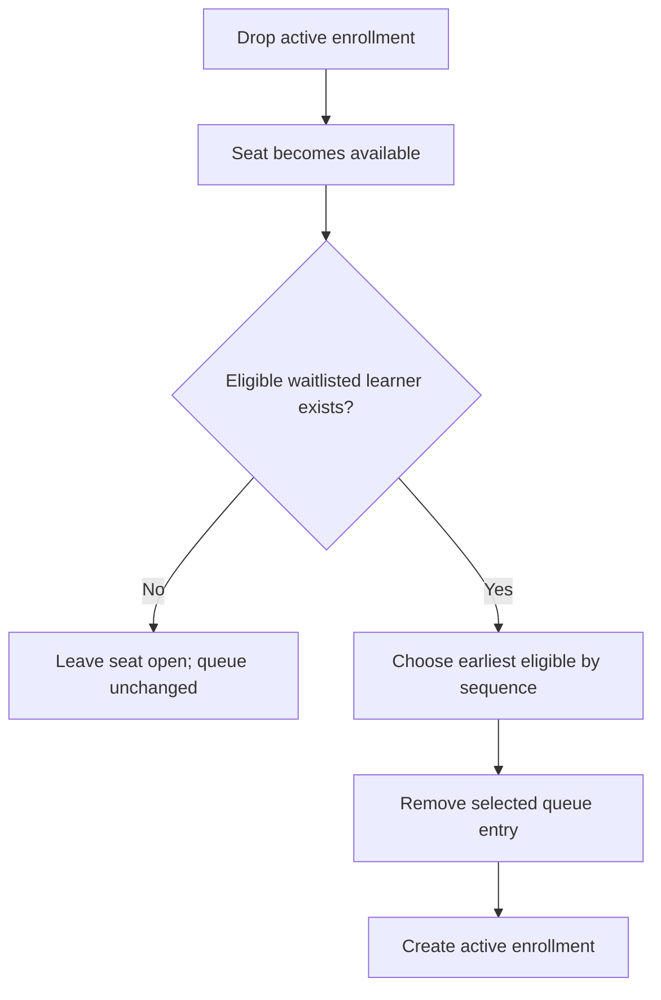

# Design Specification

## Scope and service boundary

`CourseRegistrationService` implements enrollment, dropping, and FIFO promotion for offering ID `1`. `RegistrationDbContext` models persistence. `RegistrationDbContext.OnModelCreating` defines deterministic dummy data with `HasData`. `Program.cs` only wires dependency injection and logging, then calls `EnsureCreatedAsync()` to initialize the database from the model. The console app is only a demonstration surface; there is no frontend or API.

## Data model

- `CourseOffering`: offering ID, name, and positive capacity (the demo uses capacity 2).
- `Learner`: ID, name, and a simplified `HasPrerequisite` eligibility flag.
- `Enrollment`: active registration for a learner and offering.
- `WaitlistEntry`: learner, offering, and monotonically increasing sequence used for FIFO order.

## Enrollment workflow

1. Reject an unknown learner.
2. Reject a learner already enrolled; return a non-success waitlist result if already queued.
3. Reject a learner who does not meet the prerequisite.
4. If enrolled count is below capacity, create an enrollment; otherwise add a waitlist entry with the next sequence.

## Drop and promotion workflow

1. Find an active enrollment. If absent, reject without changing state.
2. Remove the enrollment and persist the seat release.
3. Query the waitlist in sequence order and select the first learner who currently satisfies the prerequisite.
4. Remove that queue entry and create an enrollment. Ineligible entries are skipped but retained.

## Invariants and enforcement

- **Capacity:** enrollment checks the offering capacity before adding an enrollment; promotion only runs after a drop has freed a seat.
- **No duplicate active enrollment:** the service checks existing enrollment before inserting.
- **No simultaneous enrollment and waitlist entry:** enrollment checks the queue first; promotion removes the selected queue row before adding enrollment.
- **No duplicate queue entry:** enrollment checks the waitlist before appending.
- **Eligibility:** prerequisites are checked before enrollment and again during promotion.
- **Valid drops only:** a drop removes a row only when an active enrollment exists.
- **FIFO:** each queue entry receives an increasing sequence; promotion orders by sequence and selects the first eligible learner.

These are application-level checks. EF Core InMemory is not a relational database and does not enforce uniqueness constraints or provide relational transaction semantics.

## Logging

The service uses structured `ILogger<CourseRegistrationService>` messages for successful enrollments, waitlist additions, drops, promotions, and rejected requests. Learner IDs are operational identifiers in the demo; avoid logging personal data in a real system.

## Concurrency, persistence, and trade-offs

A process-local `lock` serializes operations routed through the same service instance. The service assumes one offering and a scoped `DbContext`; a `DbContext` must not be used concurrently by multiple threads. The lock does not coordinate separate service instances or processes. EF Core InMemory cannot validate database-level race conditions, constraints, or transactions. A production relational implementation would need database constraints and an explicit transactional/concurrency strategy.

## Assumptions and risks

- Only one offering exists and its ID is `1`.
- A Boolean property represents prerequisite eligibility.
- Ineligible learners are not newly added to the queue. If a queued learner later becomes ineligible, promotion skips but retains them.
- In-memory data disappears when the process exits.
- A promotion operation handles one newly available seat per successful drop, which matches this single-seat release workflow.
